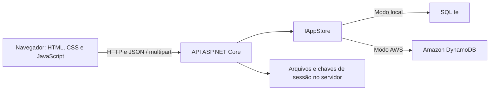

# SuporteHub

**Tecnologia que conecta. Suporte que transforma.**

Sistema de chamados para registrar solicitações, conversar com a administração e acompanhar o atendimento. Possui uma única tela de login e dois perfis: **Administrador** e **Usuário**.

O frontend e a API são servidos pela mesma aplicação ASP.NET Core. O banco pode ser **SQLite**, para uso local, ou **Amazon DynamoDB**, para armazenar contas e chamados na AWS.

**Versão atual: 1.3.1.**

## Sumário

- [Funcionalidades](#funcionalidades)
- [Perfis de acesso](#perfis-de-acesso)
- [Tecnologias utilizadas](#tecnologias-utilizadas)
- [Arquitetura e organização](#arquitetura-e-organização)
- [Executar localmente](#executar-localmente)
- [Executar com a AWS](#executar-com-a-aws)
- [Criar e verificar administradores](#criar-e-verificar-administradores)
- [Dados, arquivos e atualização](#dados-arquivos-e-atualização)
- [Indicadores e exportações](#indicadores-e-exportações)
- [API](#api)
- [Autenticação e segurança](#autenticação-e-segurança)
- [Testes](#testes)
- [Publicação e solução de problemas](#publicação-e-solução-de-problemas)

## Funcionalidades

### Área do usuário

- Criar uma conta e entrar com e-mail e senha.
- Abrir chamados com assunto, descrição, categoria e prioridade.
- Consultar somente os próprios chamados.
- Buscar por número ou assunto e filtrar por status e categoria.
- Acompanhar o histórico e as respostas do administrador.
- Enviar respostas e anexos enquanto o chamado estiver aberto.
- Baixar os anexos autorizados do chamado.
- Marcar o próprio chamado como resolvido.

### Área do administrador

| Tela | Funções |
|---|---|
| Visão geral | Contagem por status, chamados ativos, distribuição por responsável e por categoria |
| Chamados | Consultar todos os chamados; buscar por número, assunto, nome ou e-mail; filtrar por prioridade, responsável, período e agrupamento de status; paginar e exportar CSV |
| Novo chamado | Abrir uma solicitação em nome de uma pessoa já cadastrada, com descrição e anexos |
| Detalhe | Consultar descrição, conversa, anexos, dados reais do solicitante e suas contagens de chamados |
| Gerenciamento | Salvar responsável, prioridade e status em uma operação; resolver, reabrir e registrar as alterações no histórico |
| Conversa | Enviar respostas públicas e notas internas, visíveis somente aos administradores |
| Atendidos | Consultar resolvidos, pessoa que resolveu, data e tempo de resolução; filtrar, paginar e exportar |
| Relatórios | Acompanhar indicadores, ranking de atendimentos, status, categorias, assuntos frequentes e evolução diária; exportar CSV e imprimir em PDF |
| Usuários | Listar contas, buscar por nome/e-mail, filtrar por perfil e cadastrar novas contas de Usuário ou Administrador |

### Classificação dos chamados

| Campo | Valores disponíveis |
|---|---|
| Status | Aberto, Em andamento, Aguardando, Resolvido |
| Prioridade | Baixa, Média, Alta, Urgente |
| Categoria | Acesso, Hardware, Rede, Sistemas, Equipamentos |

São aceitos anexos **PNG, JPG/JPEG e PDF**, de até **10 MB por arquivo**, com limite de **20 anexos por chamado**. O servidor verifica a assinatura do arquivo, além da extensão. Chamados resolvidos precisam ser reabertos pelo administrador para receber respostas ou anexos; notas internas ainda podem ser adicionadas.

A versão atual não inclui avaliação de atendimento, login com Google ou recuperação automática de senha por e-mail.

## Perfis de acesso

| Permissão | Usuário | Administrador |
|---|:---:|:---:|
| Abrir e acompanhar os próprios chamados | Sim | Sim |
| Consultar chamados de outras pessoas | Não | Sim |
| Responder e anexar arquivos em chamados autorizados | Sim | Sim |
| Resolver o próprio chamado | Sim | Sim |
| Alterar prioridade, responsável e etapas do atendimento | Não | Sim |
| Reabrir chamados | Não | Sim |
| Consultar e escrever notas internas | Não | Sim |
| Cadastrar contas e consultar relatórios | Não | Sim |

O servidor identifica o perfil após o login e o frontend abre a área correspondente. Não é necessário escolher um perfil na tela de entrada.

No **SQLite em Development, com banco vazio**, o primeiro cadastro cria um Administrador; os seguintes criam Usuários. Na **AWS** e fora do cadastro inicial local, o cadastro público cria somente Usuários. O primeiro administrador AWS deve ser criado pelo comando administrativo.

Contas antigas com perfil `agent` são reconhecidas como `admin`; contas `client`, como `user`. Essa compatibilidade preserva senhas e chamados e não reescreve o banco inteiro na inicialização. Sessões com o perfil antigo precisam entrar novamente.

Consulte [docs/ADMIN.md](docs/ADMIN.md) para o guia de administração.

## Tecnologias utilizadas

### Interface

| Tecnologia | Uso no sistema |
|---|---|
| HTML5 | Estrutura das telas, formulários e elementos de navegação |
| CSS3 | Layout responsivo com Flexbox, Grid, variáveis de tema e estilos para impressão |
| JavaScript | Renderização das telas, validações de interface, filtros, paginação e navegação por hash (`#/...`) |
| DOM e Fetch API | Manipulação da interface e comunicação HTTP com a API na mesma origem |
| FormData | Envio de arquivos multipart |
| SVG | Gráfico de evolução diária dos chamados |
| Blob e Object URLs | Geração e download dos arquivos CSV no navegador |
| Impressão do navegador | Exportação dos relatórios com a opção Salvar como PDF |
| Manrope / Google Fonts | Tipografia da interface, com fontes do sistema como alternativa quando a fonte externa não estiver disponível |

A interface usa JavaScript sem framework e não exige instalação de dependências npm para funcionar. A geração de PDF não depende de um serviço externo ou de uma biblioteca de PDF no servidor.

### API e armazenamento

| Tecnologia | Uso no sistema |
|---|---|
| C# e .NET 10 | Linguagem e plataforma do backend |
| ASP.NET Core | Servidor HTTP, controllers, API REST, autenticação, autorização e arquivos estáticos |
| Kestrel | Servidor web utilizado na execução da aplicação |
| Injeção de dependências | Registro dos serviços e seleção da implementação de armazenamento |
| Data Annotations | Validação dos campos dos DTOs recebidos pela API |
| System.Text.Json | Serialização das entidades e respostas JSON |
| Autenticação por cookies | Sessões de login emitidas pelo servidor |
| PasswordHasher do ASP.NET Core | Hash e verificação de senhas com PBKDF2 |
| ASP.NET Core Data Protection | Proteção dos cookies e persistência das chaves de sessão |
| ASP.NET Core Rate Limiting | Limite de tentativas nas operações de autenticação |
| OpenAPI | Descrição dos endpoints, disponível em Development |
| SQLite / Microsoft.Data.Sqlite | Banco local persistente, transações, IDs atômicos e atualizações condicionadas à versão |
| Amazon DynamoDB / AWS SDK for .NET | Banco na AWS, leituras consistentes, contador atômico e escritas condicionais |
| AWS IAM e SigV4 | Permissões e assinatura das requisições ao DynamoDB pelo SDK |
| AWS CLI v2 | Configuração do perfil e verificações de identidade/tabela no computador |
| IAM Identity Center / SDK SSO | Suporte opcional a perfis AWS autenticados por SSO |

O SQLite é acessado diretamente pelo driver; não há Entity Framework ou outro ORM no projeto. As bibliotecas nativas do SQLite são distribuídas pelos pacotes NuGet, sem exigir instalação separada de um servidor de banco.

### Pacotes NuGet diretos

As versões declaradas em [SuporteHub.API.csproj](backend/SuporteHub.API/SuporteHub.API.csproj) são:

| Pacote | Versão | Finalidade |
|---|---|---|
| Microsoft.Data.Sqlite | 10.0.13 | Acesso ao SQLite |
| Microsoft.AspNetCore.OpenApi | 10.0.13 | Documento OpenAPI |
| AWSSDK.DynamoDBv2 | 4.0.108 | Operações DynamoDB |
| AWSSDK.SSO | 4.0.100.22 | Credenciais de perfis SSO |
| AWSSDK.SSOOIDC | 4.0.100.21 | Fluxo OIDC dos perfis SSO |

### Ferramentas de desenvolvimento, infraestrutura e testes

| Tecnologia | Finalidade | Necessária para executar normalmente? |
|---|---|---|
| SDK .NET 10 / NuGet / MSBuild | Restaurar pacotes, compilar, executar e publicar | Sim, para executar a partir do código-fonte |
| PowerShell | Comandos Windows e script de inicialização AWS | Para os comandos Windows apresentados |
| Bash | Scripts alternativos de inicialização em Linux/macOS | Não no Windows |
| Git / GitHub | Versionamento e distribuição do código | Não para executar um ZIP extraído |
| Python 3 / unittest | Testes de integração da API e automação de cenários | Somente para testes |
| Node.js | Execução da suíte de navegador em JavaScript | Somente para essa suíte |
| Playwright / Chromium | Testes reais de navegação, permissões, arquivos e relatórios | Somente para testes de navegador |
| PowerShell 7 | Execução da suíte específica do script AWS com comandos simulados | Somente para essa suíte |
| Docker / Docker Compose | DynamoDB Local opcional para desenvolvimento e testes | Não para SQLite ou DynamoDB real na AWS |
| DynamoDB Local | Testar o armazenamento DynamoDB sem acessar uma tabela AWS | Somente para esse modo de teste |
| AWS CloudFormation / YAML | Template de infraestrutura preservado no repositório | Não para conectar a tabela já existente |

O template [infra/dynamodb.yml](backend/SuporteHub.API/infra/dynamodb.yml) descreve uma tabela e uma política IAM. Sua presença não significa que ele seja aplicado automaticamente. Os índices secundários, Streams e demais recursos declarados no template não são necessários aos fluxos atuais da API, que não utiliza esses índices ou consome os Streams.

## Arquitetura e organização



O provedor é selecionado por configuração. A aplicação usa um banco por execução; não sincroniza SQLite e DynamoDB automaticamente.

```text
backend/SuporteHub.API/
  Controllers/       Autenticação, chamados, usuários e administração
  DTOs/              Contratos e validação das requisições
  Models/            Contas, chamados, histórico e anexos
  Services/          Validação das sessões
  Storage/           IAppStore, SqliteStore e DynamoStore
  Properties/        Perfis de execução http, https e aws
  infra/             Template CloudFormation
  Program.cs         Configuração, serviços, comandos e inicialização
frontend/
  css/style.css      Estilos, responsividade e impressão
  js/app.js          Comunicação HTTP, sessão e roteamento
  js/auth.js         Login e cadastro
  js/chamados.js     Formulários, listas e detalhe do usuário
  js/dashboard.js    Visão geral e indicadores compartilhados
  js/admin.js        Telas administrativas e relatórios
  index.html         Página inicial
scripts/             Inicialização local e AWS
tests/               Suítes de integração e navegador
docs/               Guias detalhados de administração e AWS
.local/              Dados locais ignorados pelo Git
```

Os arquivos do frontend são copiados para `wwwroot` na compilação e publicação e servidos junto da API. Não abra `index.html` diretamente nem hospede apenas o frontend: os fluxos dependem da API na mesma origem.

## Executar localmente

### Pré-requisitos

Instale o **SDK .NET 10**: [download oficial](https://dotnet.microsoft.com/download/dotnet/10.0).

O modo SQLite não precisa de Docker, WSL, virtualização ou credenciais AWS.

### Windows

Extraia o projeto e abra o PowerShell na pasta que contém `backend`, `frontend` e `scripts`. Execute:

```powershell
dotnet run --project backend/SuporteHub.API/SuporteHub.API.csproj --launch-profile http
```

O comando restaura as dependências, compila e inicia o sistema. Mantenha o terminal aberto e acesse:

- Aplicação: http://localhost:5218
- Saúde do banco e versão: http://localhost:5218/api/health

Na primeira execução local com banco vazio, use **Criar conta** para cadastrar o Administrador. Não existem e-mails ou senhas padrão. Para encerrar, pressione `Ctrl+C`.

### Linux/macOS

O mesmo comando `dotnet run` funciona com o SDK instalado. Como alternativa:

```bash
dotnet build backend/SuporteHub.API/SuporteHub.API.csproj
./scripts/start.sh
```

O script inicia a DLL compilada com caminhos locais absolutos. Após modificar o backend, compile novamente.

## Executar com a AWS

Este modo mantém a aplicação no computador/servidor que executa a API e armazena contas e chamados no DynamoDB. Ele não publica automaticamente o site na internet.

| Configuração | Valor do projeto |
|---|---|
| Provedor | DynamoDB |
| Região | `sa-east-1` — São Paulo |
| Tabela existente | `suportehub-dev` |
| Stack informada | `suportehub-dev` |
| Chave de partição | `PK`, String |
| Chave de ordenação | `SK`, String |

Instale a [AWS CLI v2](https://awscli.amazonaws.com/AWSCLIV2.msi) e configure uma identidade com acesso à tabela. O login do console AWS pelo navegador, sozinho, não autentica a API.

Para um perfil com credenciais locais:

```powershell
aws configure --profile suportehub
```

Para uma organização com IAM Identity Center já configurado:

```powershell
aws configure sso --profile suportehub
aws sso login --profile suportehub
```

O script usa o perfil `suportehub` por padrão; acrescente `-AwsProfile NOME_DO_PERFIL` se precisar de outro. Não coloque chaves no código ou no Git. O script verifica a identidade e exige `DescribeTable`; a aplicação usa `GetItem`, `PutItem`, `Query` e `UpdateItem` na tabela. A política mínima e as instruções de IAM estão em [docs/AWS.md](docs/AWS.md).

Na raiz do projeto, verifique sem gravar registros:

```powershell
powershell -NoProfile -ExecutionPolicy Bypass -File .\scripts\start-aws.ps1 -CheckOnly
```

Para iniciar:

```powershell
powershell -NoProfile -ExecutionPolicy Bypass -File .\scripts\start-aws.ps1
```

A opção `ExecutionPolicy Bypass` vale apenas para esse processo PowerShell. O script confere o esquema da tabela, impede conflito com um servidor anterior na porta 5218, compila e executa a DLL com configuração AWS explícita. O backend recusa um banco local ou destino inesperado quando iniciado por esse roteiro. A inicialização normal não cria, apaga ou redefine uma tabela AWS.

Abra http://localhost:5218/api/health e confirme:

```json
{
  "status": "ok",
  "database": "DynamoDB",
  "table": "suportehub-dev",
  "region": "sa-east-1",
  "version": "1.3.1"
}
```

A tela de login informa **Banco AWS** ou **Banco local**. O perfil `aws` de `launchSettings.json` e o script Bash `scripts/run-aws.sh` são alternativas; no Windows, o roteiro principal é `start-aws.ps1`.

## Criar e verificar administradores

### No banco AWS

Pare a API com `Ctrl+C` e use o mesmo script e perfil AWS em todas as operações.

Criar um administrador com e-mail ainda não cadastrado:

```powershell
powershell -NoProfile -ExecutionPolicy Bypass -File .\scripts\start-aws.ps1 -CreateAdmin
```

Transformar uma conta já existente em administradora, preservando a senha:

```powershell
powershell -NoProfile -ExecutionPolicy Bypass -File .\scripts\start-aws.ps1 -PromoteAdmin
```

Consultar somente o perfil salvo:

```powershell
powershell -NoProfile -ExecutionPolicy Bypass -File .\scripts\start-aws.ps1 -CheckAccount
```

Informe o e-mail solicitado no terminal. A criação também pede nome e senha de **10 a 128 caracteres**. Criar/promover só confirma sucesso depois de reler a conta no banco com `Perfil: admin`. E-mail duplicado não substitui a senha: use promoção para uma conta existente.

Depois, inicie o sistema sem opções e entre com essa conta na tela de login, sem fazer outro cadastro público.

### No banco local

A primeira conta de um banco local Development vazio já é Administrador. Para promover uma conta existente:

```powershell
dotnet run --project backend/SuporteHub.API/SuporteHub.API.csproj --launch-profile http -- --promote-admin
```

Também existem os comandos `--create-admin` e `--check-account` nesse mesmo perfil. Os comandos de terminal exigem acesso ao computador/servidor. Um Administrador autenticado também pode cadastrar contas pela tela **Usuários**.

## Dados, arquivos e atualização

### Diretórios persistentes

| Conteúdo | Modo SQLite | Modo AWS |
|---|---|---|
| Contas, chamados e histórico | `.local/suportehub.db` | Tabela DynamoDB configurada |
| Conteúdo dos anexos | `.local/uploads` | `.local/aws-uploads` |
| Chaves de proteção das sessões | `.local/keys` | `.local/aws-keys` |

Mesmo no modo AWS, os anexos e as chaves ficam no computador/servidor da API. O projeto não envia arquivos ao S3. Perder os arquivos locais pode tornar anexos indisponíveis e invalidar sessões.

Para atualizar pelo ZIP: pare a aplicação, faça backup e preserve a pasta `.local` na nova raiz antes de iniciar. Arquivos de banco, anexos e chaves são ignorados pelo Git. Contas locais não são copiadas automaticamente para a AWS, e o projeto não migra dados entre os provedores.

O `compose.yml` preserva um modo opcional com DynamoDB Local em `127.0.0.1:8000`. Ele não participa da inicialização SQLite ou da conexão à AWS real. Não apague `.local/dynamodb` se ainda precisar de dados desse modo anterior.

### Estrutura DynamoDB

O armazenamento usa um padrão de tabela única:

| PK | SK | Conteúdo |
|---|---|---|
| `USERS` | E-mail normalizado | Conta, perfil e hash de senha |
| `TICKETS` | `TICKET#0000000001` | Chamado, histórico, notas e metadados dos anexos |
| `META` | `TICKET_COUNTER` | Contador atômico `NextId` |

Entidades usam `Data` como JSON e `Version` numérico para controlar atualizações concorrentes. O SQLite usa uma tabela `Records` com esse mesmo contrato lógico e uma tabela `Counters`. A API limita o JSON serializado de uma entidade a 300.000 bytes para manter histórico e anexos dentro dos limites previstos.

## Indicadores e exportações

- **Período dos relatórios:** filtra pela data de abertura dos chamados.
- **Taxa de resolução:** quantidade atualmente resolvida dividida pelo total aberto no período.
- **Primeira resposta:** média do tempo entre a abertura e a primeira resposta pública identificada de um administrador.
- **Ranking:** usa quem efetivamente resolveu, sem atribuir a um administrador uma resolução feita pelo próprio usuário.
- **Atendidos:** usa a última resolução registrada. Reabrir limpa data e autor da resolução; resolver novamente registra a nova conclusão.
- **Dados antigos:** tempos ou autoria ausentes aparecem como `—` e não são inventados. Resolvidos antigos sem data aparecem ao selecionar Todo o período.
- **CSV:** exporta os resultados filtrados, com proteção de células que poderiam ser interpretadas como fórmulas.
- **PDF:** abre a impressão do navegador; escolha Salvar como PDF.

## API

Todas as rotas usam a mesma origem da página. As respostas são JSON, exceto arquivos, respostas vazias e recursos estáticos.

| Método | Rota | Finalidade / acesso |
|---|---|---|
| GET | `/api/health` | Verificar banco, tabela, região e versão; público |
| GET | `/api/auth/setup` | Consultar disponibilidade do cadastro inicial local; público |
| POST | `/api/auth/cadastro` | Cadastro público de usuário, com exceção do primeiro administrador local |
| POST | `/api/auth/login` | Autenticar com e-mail e senha |
| GET | `/api/auth/me` | Consultar a conta da sessão |
| POST | `/api/auth/logout` | Encerrar a sessão |
| GET, POST | `/api/chamados` | Listar chamados autorizados ou abrir um chamado próprio |
| GET | `/api/chamados/{id}` | Consultar detalhes autorizados |
| POST | `/api/chamados/{id}/respostas` | Enviar resposta pública |
| PATCH | `/api/chamados/{id}/status` | Administrador altera etapas; usuário resolve o próprio chamado |
| PATCH | `/api/chamados/{id}/responsavel` | Atribuir administrador; somente Administrador |
| PATCH | `/api/chamados/{id}/gerenciar` | Salvar prioridade, responsável e status juntos; somente Administrador |
| POST | `/api/chamados/{id}/notas` | Registrar nota interna; somente Administrador |
| POST | `/api/chamados/{id}/anexos` | Enviar multipart com campo `arquivo` |
| GET | `/api/chamados/{id}/anexos/{fileId}` | Baixar anexo autorizado |
| GET | `/api/admin/usuarios` | Listar contas; somente Administrador |
| POST | `/api/admin/usuarios` | Criar Usuário ou Administrador; somente Administrador |
| GET | `/api/admin/solicitantes/{email}` | Dados e contagens do solicitante; somente Administrador |
| POST | `/api/admin/chamados` | Abrir em nome de uma pessoa cadastrada; somente Administrador |
| GET | `/api/equipe` | Listar administradores disponíveis para atribuição; somente Administrador |

Em Development, o documento OpenAPI fica em `/openapi/v1.json`. Não há uma interface Swagger UI incluída.

## Autenticação e segurança

- Senhas são armazenadas como hash, nunca em texto puro, e não são retornadas pela API.
- A sessão usa cookie HttpOnly, SameSite Strict e Secure quando a conexão é HTTPS; sua validade é de oito horas, com renovação deslizante.
- O servidor valida o perfil da conta ao verificar a sessão; uma sessão cujo perfil ficou desatualizado precisa autenticar novamente.
- A autorização é aplicada na API: ocultar um menu não concede nem remove permissões.
- Usuários comuns só acessam seus chamados; notas internas são removidas das respostas destinadas a eles.
- Operações de alteração em `/api` exigem o cabeçalho `X-Requested-With: SuporteHub`. Não há CORS liberado para outras origens.
- Operações sujeitas à política de autenticação possuem limite de 30 tentativas por minuto por IP.
- A interface escapa textos antes de inseri-los no HTML; senhas e tokens não são armazenados em web storage.
- Arquivos são validados no servidor e baixados por rotas que verificam a sessão e o acesso ao chamado.
- Escritas condicionais à versão evitam sobrescrever silenciosamente alterações concorrentes.
- Credenciais AWS devem ficar no perfil local, em uma identidade da plataforma ou em um mecanismo seguro da hospedagem, fora dos arquivos versionados.

Use HTTPS ao disponibilizar o sistema publicamente e preserve as chaves de Data Protection entre reinícios.

## Testes

Compile a API antes de executar:

```powershell
dotnet build backend/SuporteHub.API/SuporteHub.API.csproj
```

| Arquivo | Cobertura | Requisitos adicionais |
|---|---|---|
| `tests/integration.py` | Inicialização, perfis, isolamento, arquivos, validações, concorrência e persistência SQLite | Python 3 |
| `tests/browser.cjs` | Cadastro, login, chamados, respostas, anexos, busca, erros e relatórios no navegador | Node.js, Playwright e Chromium |
| `tests/admin.py` | Permissões, cadastro de contas, notas privadas, promoção, compatibilidade de contas antigas e telas administrativas | Python 3, Playwright para Python e Chromium |
| `tests/dynamodb_admin.py` | Criação/promoção de administrador, confirmação, sessão, cache, reinício e navegador com DynamoDB Local | Python 3, Playwright, Chromium e DynamoDB Local descartável em loopback |
| `tests/aws_launcher.py` | Script PowerShell com comandos AWS/.NET simulados; opções, banco explícito, porta ocupada e falha de compilação | Python 3 e PowerShell 7; suíte validada em Linux |

Suítes SQLite, sem Docker ou AWS:

```bash
python3 tests/integration.py
node tests/browser.cjs
python3 tests/admin.py
```

Instale Playwright no ambiente de testes conforme a suíte: `npm install --no-save --package-lock=false playwright` para Node.js e `python3 -m pip install playwright` para Python. Instale também Chromium ou indique o executável em `CHROMIUM_BIN`. `DOTNET_BIN` permite indicar o caminho do .NET.

Para as suítes específicas:

```bash
DYNAMODB_TEST_ENDPOINT=http://127.0.0.1:8000 python3 tests/dynamodb_admin.py
PWSH_BIN=/caminho/para/pwsh python3 tests/aws_launcher.py
```

Esses dois exemplos usam sintaxe Bash. O endpoint DynamoDB deve ser de uma instância **descartável de teste**, não da tabela AWS ou de uma instância com dados que você queira preservar. A suíte cria uma tabela com nome único nessa instância. Os demais testes usam bancos, contas e arquivos temporários separados dos dados reais. O teste do script usa comandos simulados e não confirma credenciais AWS reais.

Para conferir vulnerabilidades conhecidas nas dependências NuGet:

```powershell
dotnet list backend/SuporteHub.API/SuporteHub.API.csproj package --vulnerable --include-transitive
```

## Publicação e solução de problemas

### Gerar os arquivos de publicação

```powershell
dotnet publish backend/SuporteHub.API/SuporteHub.API.csproj -c Release -o ./artifacts/app
```

A pasta de saída contém a aplicação e `wwwroot`. Mantenha esses arquivos juntos. Publicar com `dotnet publish` gera os arquivos, mas não contrata hospedagem, configura domínio ou coloca o site na internet.

Uma implantação com várias instâncias precisa compartilhar o armazenamento de anexos e as chaves de sessão. Integração com S3, implantação automática e configuração de hospedagem não fazem parte desta versão.

### Problemas frequentes

| Sintoma | O que verificar |
|---|---|
| `dotnet` não reconhecido | Instale o SDK .NET 10 e abra um novo terminal |
| `aws` não reconhecido | Instale a AWS CLI v2 e abra um novo terminal |
| Porta 5218 ocupada | Pare a versão anterior com `Ctrl+C` antes de iniciar outra |
| Interface antiga ou perfil incorreto | Use os arquivos atuais, confirme `/api/health`, faça a verificação da conta, atualize com `Ctrl+F5` e entre novamente |
| Conta local não entra no modo AWS | Contas não são sincronizadas entre os bancos; crie ou promova a conta no provedor correto |
| `AccessDeniedException` | Confira a identidade IAM e as permissões na tabela; veja [docs/AWS.md](docs/AWS.md) |
| `/api/auth/me` sem resposta visível antes do login | A rota exige sessão; HTTP 401 sem corpo é esperado |
| Erro 404 | Use exatamente `http://localhost:5218`, com a API em execução, sem asteriscos ou outros caracteres no endereço |
| Anexo indisponível | Confira se os arquivos persistentes da API foram preservados junto dos metadados do banco |

Caso a pasta compilada esteja desatualizada, pare a API e execute `dotnet clean` no projeto antes de iniciar novamente. Não apague `.local` para corrigir a compilação.

Guias complementares: [Administração](docs/ADMIN.md) e [Configuração AWS](docs/AWS.md).
